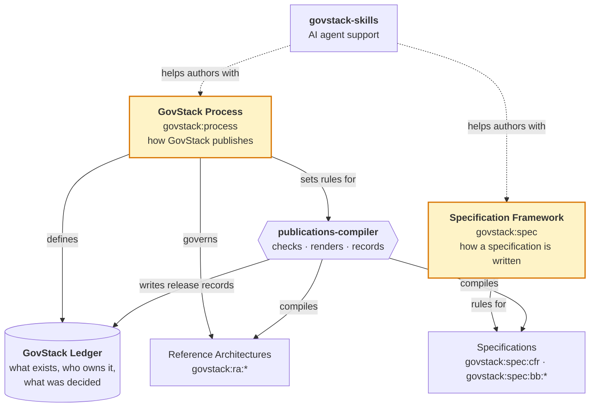
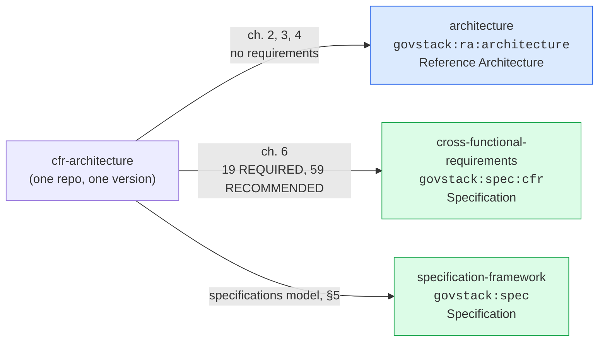
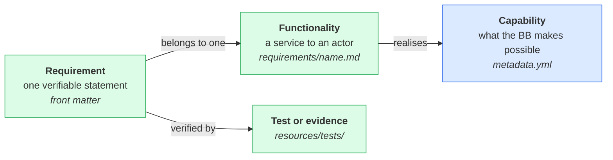
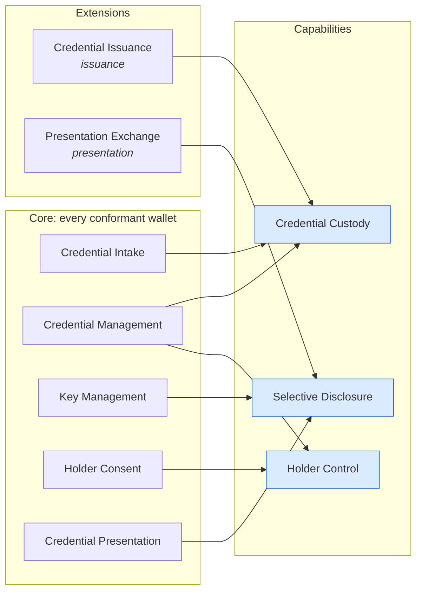
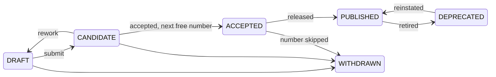
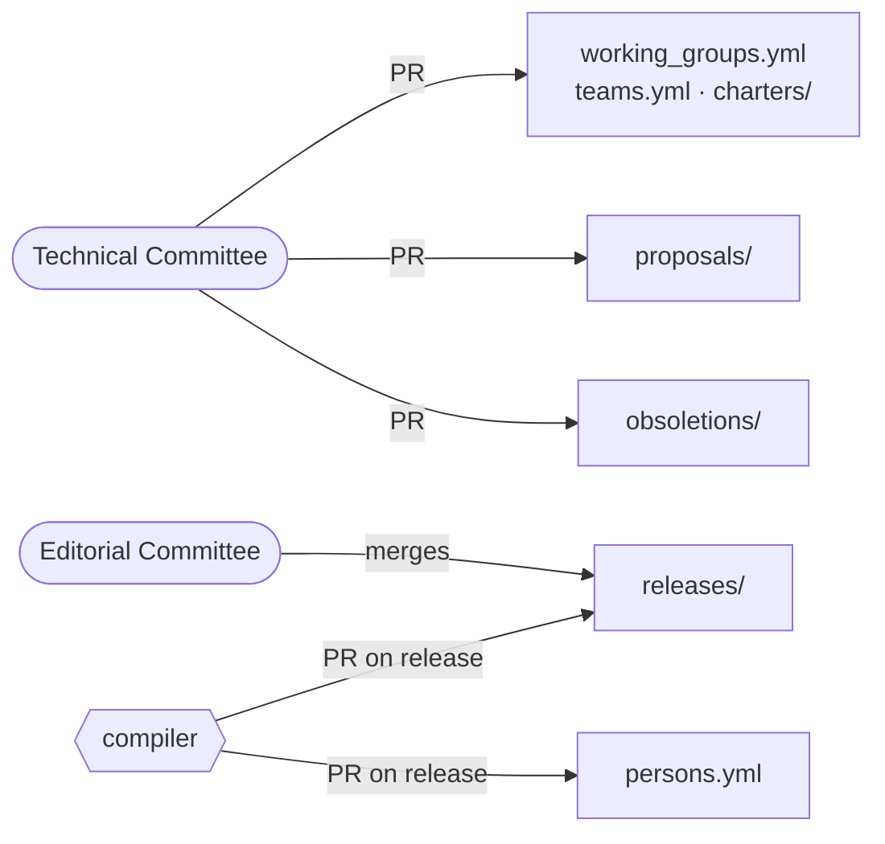
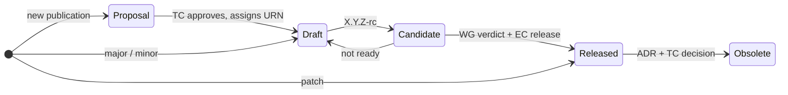
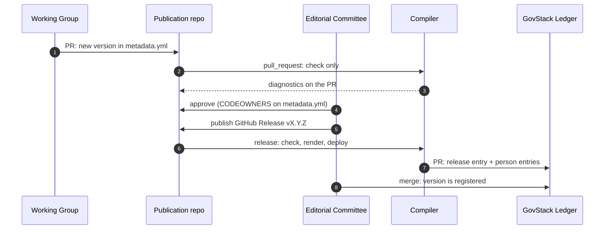

# One framework for every GovStack publication

## Why we changed it, and the pieces that make it up

Architecture Working Group · November 2026

<!--
The first two slides say why. Then the publication pieces, the specification model (capabilities to versioning), the ledger and pipeline, and finally what we need decided.
-->

---

# Why we changed it

Three problems, found separately by different groups:

| Problem | Where it showed up |
|---|---|
| **One requirement was spread across five chapters**, and its test was in none | Every 1.0 Building Block specification |
| **One repository held three kinds of document** with one version number. A typo in the architecture text produced a new CFR version | `cfr-architecture` |
| **Every functionality bound every product.** A specification could not have an optional part, or obligations towards another role | Wallet and Payments Working Groups |

A person can read around these gaps. GovMarket, a compiler or an AI agent cannot: it stops or guesses.

> **Goal:** every publication can be checked, indexed and released by a tool, and every requirement can be verified against a product.

---

# The pieces



**Process** says how anything is published. **Specification Framework** says how a specification is written. The other three are tools and records that follow from them.

---

# Splitting `cfr-architecture` in three



| Publication | Requirements are about | Assessed by |
|---|---|---|
| GovStack Architecture | nothing: it is informative | n/a |
| Cross-Functional Requirements | software | GovMarket |
| Specification Framework | specifications, including itself | publication review |

Each now has its own review, its own version number and its own checks. Building Blocks extend the CFR, not the architecture.

---

# Publication types

| Type | Namespace | Normative? | Publications |
|---|---|---|---|
| **Reference Architecture** | `govstack:ra:` | No | PAERA, GovStack Architecture, Domain Reference Architectures |
| **Specification** | `govstack:spec:` | Yes | Specification Framework, CFR, Building Block specifications |
| **Guide** | `govstack:guide:` | No | Implementation Playbook, Service Patterns, implementation guides |
| **Terminology** | `govstack:terminology:` | Rules only | Crafting GovStack Terminologies, shared terminologies |
| *Process* | `govstack:process` | n/a | GovStack Process |

- **The test:** a publication is a specification only if something can be assessed against it.
- **One identifier syntax** for publications, groups and people: `govstack:<class>[:<node>]:<name>`. Identifiers are never reassigned.
- **Under evaluation:** Reference Use Cases (PROC-ADR-2).

<!--
A Domain Reference Architecture references Building Blocks one way only. A BB never depends on an RA, or it would stop being generic. A role in an RA that needs conformance graduates into its own BB specification.
-->

---

# Old and new Specification Framework

| | **Old** (1.0 template + `cfr-architecture` §5) | **New** (`specification-framework`) |
|---|---|---|
| Layout | Ten chapters | ISO/IEC/IEEE 29148 SRS: introduction, one file per functionality, resources |
| A requirement | Prose in ch. 6, API in ch. 8, data in ch. 7, test in a separate folder | One entry in YAML front matter: statement, classifiers, API operation, test |
| Identifier | None, or renumbered between versions | A number never reused or renumbered |
| Classifiers | `REQUIRED` / `RECOMMENDED` / `DRAFT` / `DEPRECATED` in one list | **Level** and **status** separate, plus observability, mutability, interaction type |
| Scope | Every functionality binds every product | **Core** plus optional **extensions**, linked to declared **capabilities** |
| Versioning | One shared number with the architecture | Semantic versioning for each specification, with rules for what counts as breaking, and a changelog |
| Decisions | Not recorded | TDRs in the specification's `ADR/` folder |

<!--
Proposed, not decided: ARCH-ADR-5 (level vs status), ARCH-ADR-7 (core and extensions), ARCH-TDR-1 (capabilities).
-->

---

# From capability to test



| Layer | Answers | Written for | Normative? |
|---|---|---|---|
| Capability | What the Building Block makes possible | A decision-maker or buyer | No |
| Functionality | What a conformant solution does, and for which actor. Core or extension | An implementer or assessor | Yes, through its requirements |
| Requirement | One thing the system under test does or is | GovMarket, test authors | Yes |

Every link is a declared field, so the compiler can check that nothing hangs loose.

---

# Capabilities <span class="text-sm opacity-60">(ARCH-TDR-1, proposed)</span>

An outcome for the beneficiaries, named in the *Purpose*: "Credential Custody", not "Stores credentials". It says **what**, never **how**: no product, vendor, protocol or technology.

```yaml
# metadata.yml
capabilities:
  - id: custody
    title: Credential Custody
    description: A person keeps the credentials issued to them and can use them whenever they need to.
```

1. Every capability is realised by at least one functionality.
2. Every functionality realises at least one capability.
3. A capability realised by a core functionality is provided by every conformant solution. One realised only by extensions is provided only by solutions that claim them.

**Why not put requirements under capabilities?** The link is many-to-many. Credential Custody spans the core and an extension, so a capability would have to be cut along a conformance line instead of a value line.

<!--
Before: capabilities were bold words in the Purpose, and the functionality's `capability` field held a description of the functionality itself. Nothing could check the link.
-->

---

# Functionalities

A service the Building Block provides to an actor outside it, realised by a set of requirements. It is the "feature" of ISO/IEC/IEEE 29148, and the unit a specification is organised by.

| Part | Field | Content |
|---|---|---|
| Title | `title` | The name used in the overview, and the file name |
| Description | `description` | What it provides, in business terms, without requirements language |
| Realises | `realises` | The ids of the capabilities it realises |
| Conformance | `conformance`, `extension` | `CORE`, or `EXTENSION` and which one |
| Requirements | `requirements` | The requirements that realise it |
| Body | below the front matter | Workflows and data structures. No requirements hidden in prose |

- One file per functionality in `requirements/`. The functionalities named in the overview are exactly those files.
- A functionality no actor reaches is usually an internal mechanism. Express it as requirements of another functionality.

---

# Core and extensions <span class="text-sm opacity-60">(ARCH-ADR-7, proposed)</span>

**Core:** what makes a solution an instance of the Building Block. Never empty, never depends on an extension.

**Extension:** a named set of functionalities a solution may claim in addition. All or nothing: claim it and you meet every `REQUIRED` requirement in it.

| Make it an extension when | Example |
|---|---|
| Some conformant products legitimately lack it | A Payments Hub that does not issue vouchers |
| It is an obligation towards a role in a domain | A wallet's exchange with an Issuer over OpenID4VCI |
| It depends on infrastructure not every deployment has | Checking issuers against a trust registry |

- GovMarket shows claims as facts, not a score: **"Wallet 2.0: core, Issuance, Presentation"**. Buyers can filter and cite them.
- Requirements of an unclaimed extension are *not applicable*: neither passed nor failed.
- **Warning signs:** every product would claim it (it is core); it has no `REQUIRED` requirement (it guarantees nothing); it can be assessed without the core (it is a separate Building Block).

<!--
Not to be confused with: `extends` (one spec inherits another), a profile (a separate spec narrowing a BB for one context), a variation point (ARCH-ADR-6: one requirement, several alternatives). Never call an extension "optional": that word already means RECOMMENDED.
-->

---

# Example: the Wallet



- A crypto hardware wallet that holds no issued credential **fails the core**.
- A wallet that imports credentials from files and presents remotely claims **presentation** only.
- A wallet built for a credentials ecosystem claims **both**.
- Payments uses the same mechanism: the Payments Hub as core, four separately assessed extensions.

---

# Writing a requirement

Its subject is always the **system under test**. A statement about a person or another system cannot be assessed.

> [Condition] [Subject] [Action] [Object] [Constraint] *(ISO/IEC/IEEE 29148, 5.2.4)*
>
> *When a Verifier requests a presentation*, **the Wallet shows the Holder** *every requested attribute* *before any attribute is sent*.

| Common mistake | Instead |
|---|---|
| "A holder MUST be able to add credentials" | "The Wallet accepts credentials from …" |
| "The Wallet stores and encrypts credentials" | Two requirements: they may differ in level and test |
| "The Wallet is secure" | State what makes it so, or leave it to the CFR |
| "The Wallet uses OpenIAM" | Name the contract, not the product |

- Obligation comes from the `level` field, not the verb.
- Checked against the 29148 properties: necessary, unambiguous, singular, verifiable, traceable …
- Shared requirements (transport security, logging) live in the CFR and are inherited, never restated.

---

# A requirement is data <span class="text-sm opacity-60">(illustrative)</span>

```yaml
---
title: Credential Presentation
description: The holder presents a credential to a verifier.
realises: [disclosure]          # capabilities declared in metadata.yml
conformance: CORE               # or EXTENSION, with extension: <id>
requirements:
  - id: '7'
    status: PUBLISHED           # lifecycle
    level: REQUIRED             # obligation
    observability: OBSERVABLE
    mutability: EXTENSIBLE
    interaction: SERVICE_API
    statement: The Wallet presents a credential the holder selects.
    api_operation_id: presentCredential
    test: tests/presentation.feature
---
Body: the functionality, its workflows and its data structures.
```

The compiler validates every field against a closed list. GovMarket and an AI agent read the same file a person does, without interpretation. Cited anywhere as `govstack:spec:bb:wallet#req-7`.

---

# Classifiers

| Field | Values | Answers |
|---|---|---|
| `level` | **REQUIRED** · RECOMMENDED | Does a solution fail without it? GovMarket reports the share of RECOMMENDED met |
| `status` | DRAFT · CANDIDATE · ACCEPTED · WITHDRAWN · PUBLISHED · DEPRECATED | Where it stands in its life cycle |
| `observability` | OBSERVABLE · AUDITABLE | Verified from outside the running system, or by inspecting evidence the vendor provides |
| `mutability` | IMMUTABLE · EXTENSIBLE · REPLACEABLE · INAPPLICABLE | What an extending specification, such as a national profile, may do with it |
| `interaction` | SERVICE_API · CONSUMED_API · PROTOCOL · EVENT · USER_INTERFACE · DEVICE · FILE · INTERNAL | Which boundary it is exercised at, so which test harness it needs |

- One value per classifier, a default for each, and every change of a classifier means a new version.
- **Level and status used to be one list.** A draft has an intended level, and approving it should not change it (ARCH-ADR-5, proposed).
- Prefer observable: "keeps credentials across a restart" can be tested; "stores credentials in a database" cannot, and names a design.

---

# Life cycle and stable identifiers



- A number is issued on **acceptance**, and is **never removed, reused or renumbered**. A law that cites requirement 7 still means the same rule years later.
- A published requirement is never withdrawn, only deprecated. It keeps its text so a past compliance claim can be audited.
- Only `PUBLISHED` requirements count towards compliance. Drafts can ship for implementers to experiment with.
- The compiler checks the numbering rules on every pull request and release.

---

# Interaction types

Where a tester has to stand to see the requirement met.

| Type | The system under test … | A test needs |
|---|---|---|
| `SERVICE_API` | offers an API operation (`api_operation_id` in `api.yml`) | A client |
| `CONSUMED_API` | calls another Building Block's API | A stand-in that records calls |
| `PROTOCOL` | takes a role in a multi-party exchange, e.g. OpenID4VCI | A simulator of the other roles |
| `EVENT` | publishes or subscribes to a message | A broker or stand-in |
| `USER_INTERFACE` | shows something to a person or takes input | A manual procedure or scripted user |
| `DEVICE` | uses hardware: card reader, secure element | Reference hardware or a simulator |
| `FILE` | reads or writes a defined format | Sample files and a validator |
| `INTERNAL` | has a property that crosses no boundary | Indirect observation or evidence |

- Each interface in the overview is realised by at least one requirement of its type, and the reverse. A gap shows up as a check failure.
- A solution that claims only the core never needs the harnesses used only by extensions.

---

# What a version number promises

The unit is the whole specification. The promise covers its **normative content**: published requirements, their interfaces, their tests and what it extends.

| | Implementers | Dependents (integrators, laws, procurement, GovMarket) |
|---|---|---|
| **MAJOR** | A conformant solution may no longer conform | Something you relied on may have changed |
| **MINOR** | Still conformant. New RECOMMENDED content | Nothing you relied on changed |
| **PATCH** | Nothing to do | Nothing to do |

- **Within a major version, the REQUIRED set does not change.** A buyer can require "conformance to Wallet 2" and know what they are asking for.
- Tightening *and* loosening a REQUIRED rule are both major: each hurts a different side.
- Adding an extension is minor. Moving a functionality between core and an extension is major.
- Capabilities are informative: changing them is a patch.
- Every release has a changelog entry, and decisions go in TDRs.

---

# GovStack Ledger <span class="text-sm opacity-60">(renamed from GovStack Records)</span>



- Says **what exists, who owns it and what was decided**. Publication content stays in each publication's repository.
- **An entry is added once and never edited or deleted.** Its git history is the history of every publication.
- **Why "ledger":** that is what it is. "Records" collided with *decision records*, *release records* and *person records*, and with the registry it replaced.

<!--
Rename touches: repository name, the govstack_records.md chapter in govstack-process, the compiler requirements, and the README which still links to meta-specification.
-->

---

# Publication track



| Body | Role |
|---|---|
| Working Group | Owns the publication, drafts it, runs the review, gives the verdict |
| Technical Committee | Approves proposals and identifiers, reviews candidates, approves obsoletion |
| Editorial Committee | Approves the release, creates the `v*` tag, merges the ledger entry |

Each publication releases on its own schedule. There are no joint GovStack releases.

---

# Publication pipeline



- **One compiler for all publications**, called from a five-line `compile.yml`. Changing a rule once changes it everywhere.
- **The profile is chosen by namespace:** process, ra, guide, spec, terminology. Specifications also get a `requirements.json` and ID checks against the last release.
- Drafts and release candidates are checked, never published.

<!--
Present as designed, not running: only bb-template has compile.yml, the ledger has no entries yet, and the compiler is at milestone 1.
-->

---

# GovStack Skills

A Claude Code plugin that gives an AI agent the GovStack domain model and repository rules.

| Skill | Kind | Used for |
|---|---|---|
| `govstack-concepts` | Knowledge | What Building Blocks, specifications, maturity states and CFRs mean. Read before reasoning about content |
| `spec-mechanics` | Procedure | Repository layout, normalising a `bb-*` repo, `metadata.yml`, version bumps, releases |
| *planned:* `requirements-validator`, `specification-writer`, `procurement-writer` | Procedure | Checking requirements, drafting specifications, writing tenders from them |

- Shared tables (classifiers, naming, where the corpus lives) are written once in `shared/` and never copied between skills.
- Each publication also carries `resources/skills.md`: how an agent should work on *that* repository.
- Install with `/plugin marketplace add`, update with `git pull`.

---

# Decisions on the table

| ID | Decides | Status |
|---|---|---|
| ARCH-ADR-3 / 4 | Identifier syntax; whether a version goes inside an identifier | Proposed |
| ARCH-ADR-5 | Separate a requirement's level from its status | Proposed |
| ARCH-ADR-7 | Core and extension functionalities | Proposed |
| ARCH-TDR-1 | Declare capabilities and link functionalities to them | Proposed |
| PROC-ADR-2 | Future of Reference Use Cases | Open |
| *not yet written* | Split of `cfr-architecture`, publication types, ledger, independent releases, central compiler | Need ratifying |
| *new* | Rename GovStack Records to **GovStack Ledger** | To propose |

---

# What we need from you

1. **Decide ARCH-ADR-3 and ARCH-ADR-4 together**, before any requirement numbers are issued.
2. **Decide ARCH-ADR-5, ARCH-ADR-7 and ARCH-TDR-1**, so Wallet and Payments can restructure.
3. **Ratify the unwritten decisions** as ADRs, including the rename to GovStack Ledger.
4. **Set up releases:** create the `editorial-committee` GitHub team and add branch and tag rules to every publication repository.
5. **Review** `govstack-process` and `specification-framework` as release candidates.

---
layout: end
---

# Questions

`govstack-process` · `specification-framework` · `govstack-ledger` · `publications-compiler` · `govstack-skills` · `architecture` · `cross-functional-requirements`
